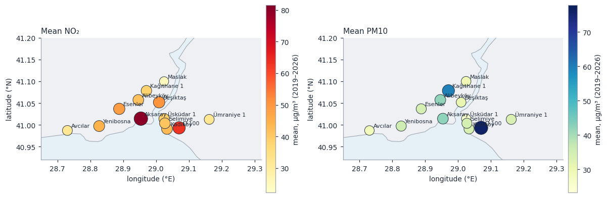
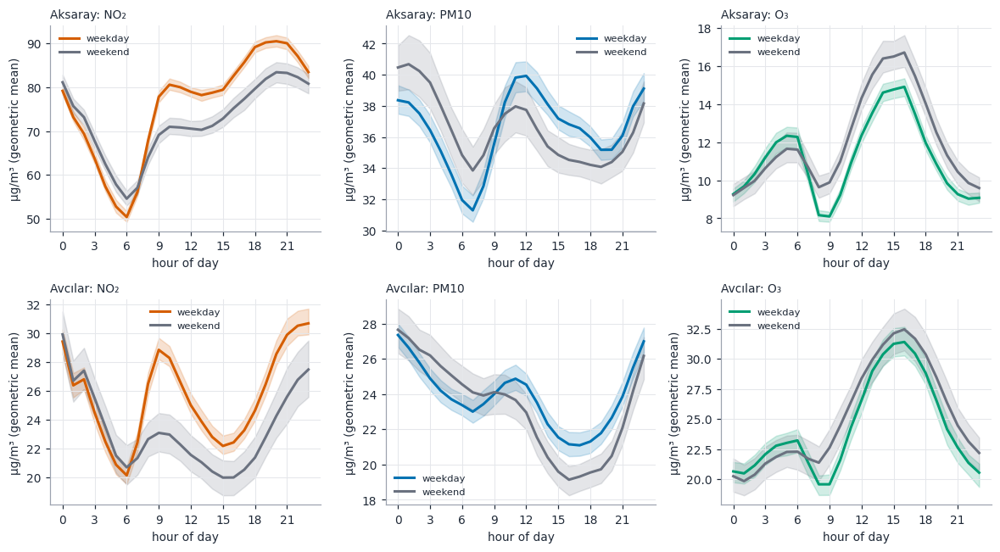

# Istanbul Air and Traffic Dashboard

[](https://github.com/SafraNako/city-air-traffic-dashboard/actions/workflows/ci.yml)

A dashboard for the **open data of the Istanbul Metropolitan Municipality (İBB)**: hourly air quality at 13 stations (2019 – October 2026) and the city's traffic
index, together with ERA5 weather, the CAMS air-quality model and public holidays. The point is not only to draw the data but to find out what it can support:
the municipality's own air-quality index is **reconstructed from its published numbers and checked against them**, the daily rhythm and the weekend effect get
honest intervals, trends are separated from weather, the traffic index is tested against what the government announced, and the two lockdowns are treated as a
natural experiment with placebo windows. Every estimator is checked against a planted truth or an independent source, and what that checking produced is listed
below, including the results that came out less clean than hoped.

It is a **visualisation of open data, not a health advisory or a regulatory assessment**. The AQI shown is the municipality's; for official information see
[havaizleme.gov.tr](https://www.havaizleme.gov.tr) and [ibb.istanbul](https://ibb.istanbul).



A ready-made page is in [`examples/pano.html`](examples/pano.html) (one self-contained 1.6 MB file; download and open it).

## What is real and what is simulated

| | |
|---|---|
| **Real** | everything on the dashboard: 13 stations × 68,232 hours (2019-01-01 to 2026-10-13) of PM10, SO₂, O₃, NO₂, CO and the municipality's AQI; the hourly traffic index since November 2021 and the daily one 2015–2024; ERA5 weather and CAMS model fields for central Istanbul; public holidays; Natural Earth land. Snapshot taken 2026-10-13; `sehir indir` refreshes it and `sehir sunucu --canli` refetches the last days |
| **Simulated** | nothing on the dashboard. Synthetic series (concentrations with planted weekend effects, trends, faults, a traffic–NO₂ link of known elasticity) exist only in the validation and the tests, where the answer must be known in advance |

## Findings along the way

These came out of the data and of the validation, not from reading about them.

1. **The published AQI is the US EPA scale in µg/m³.** The service returns a sub-index per pollutant and an overall index but documents neither. The sub-index of PM10 follows the
   trailing **24 h** mean (correlation 0.985, against 0.67 with the hourly value), O₃ and CO the trailing **8 h** mean, SO₂ and NO₂ the hourly value; at least half of the window
   must be valid; the overall index is the largest sub-index (exactly, in every hour of the Beşiktaş record). Fitting the breakpoints gives PM10 54 / 154 / 254 µg/m³ at index 50 / 100 / 150
   (the EPA values), NO₂ 102 / 192 (EPA 53 and 100 ppb at 1.92 µg/m³ per ppb), SO₂ 92.4 / 199.7 (35 and 75 ppb), O₃ 108 / 247.5, CO 5,194. The reconstruction reproduces **875,599** published hourly
   values: equal after rounding in 95.2 %, within ±1 index point in 99.69 %; fitting the breakpoints on seven stations and testing on the other six gives at least 99.25 %.
2. **Only 18 of the 28 stations ever report, and coverage is patchy.** Maslak has no NO₂ at all in 2021, Ümraniye 1 only 24 % of it, D-100 40 % in 2022; SO₂ and CO exist at some stations only.
   Thirteen stations with data throughout were kept. Avcılar reports eight negative NO₂ readings (down to −5.4 µg/m³); Maslak loses 444 NO₂ hours to repeated values and spikes.
3. **NO₂ is lower on weekends at every station, ozone is not.** Weekend / weekday ratios of the daily means (paired weeks): NO₂ 0.85–0.97 (median 0.90, all 13 intervals below 1), PM10 0.88–0.97,
   O₃ 1.00–1.14 — significantly above 1 at Esenler (1.14), D-100 (1.12) and Aksaray (1.05). That is the known weekend ozone effect: less fresh NO from traffic, less ozone consumed.
4. **Wind and the boundary layer matter in the expected direction, and the first model validation was wrong.** Wind lowers NO₂ at all 13 stations (log-log elasticity −0.10 … −0.58) and a shallow
   boundary layer raises PM10 at all 13 (−0.30 … −0.49 on its height). Leave-one-year-out R² of the daily models is 0.33 (NO₂, median; range 0.11–0.54) and 0.48 (PM10). My first design trained on
   2022 onwards and tested on 2019–2021 and gave *negative* R² at several stations: NO₂ had fallen by about 3 % a year, so the earlier levels were simply different. A time trend term fixed it; the
   lesson is that a model has to be allowed to see the level change before it is asked to predict across it.
5. **NO₂ has fallen almost everywhere, PM10 less clearly.** Seasonal Mann–Kendall on monthly means, Theil–Sen slope as a share of the mean per year: NO₂ median −3.0 %/yr, negative at 12 of 13 stations,
   significant at five (Aksaray −3.4, Kadıköy −5.3, Avcılar −7.6, Kağıthane −3.7, Selimiye −11.7); PM10 median −1.2 %/yr (10 of 13 negative; Alibeyköy −14.8 %/yr, which looks like a change of site or
   sensor rather than of the air). Aksaray, the busiest station, went from 97 µg/m³ NO₂ (2019) to 70 (2022) and 75 (2026) — and was above the WHO 24 h guideline of 25 µg/m³ on 339–355 days of every full year (2019–2025).
6. **The traffic index agrees with itself and with the calendar.** The daily means of the hourly feed and the separately published daily file correlate at r = 0.978 over 1,067 days. Public holidays on
   weekdays lower the index by 41 % [−47, −35] over 46 holidays; rainy days (≥ 1 mm) raise it by 7.5 % [+5.1, +10.0].
7. **A detector that knows only weekdays, months and the public-holiday list found the government's extra holidays.** It flagged all four weekdays added to the nine-day bayram holidays of 2024
   (8–9 April, 20–21 June). Its other 22 events include the days before bayrams, the election Sundays of 14 and 28 May 2023 (19 % and 63 % of expected traffic) and 31 March 2024 (48 %), and
   New Year's Eve (46 %); a few I cannot explain (2022-01-09, 2022-03-10, 2022-04-02/03, 2025-02-20).
8. **The lockdowns show up in traffic, much less clearly in air.** The traffic index fell by 61 % (23 March – 30 April 2020) and 58 % (29 April – 17 May 2021) against the four weeks before. The
   weather-normalised NO₂ at Aksaray in 2021 is −63 %, the lowest of about 2,500 windows (z = −6.5); Yenibosna and D-100 (−43 % each) are beyond the 95 % of placebo windows too. Pooled over stations
   NO₂ fell by a median 26 % in 2021 (8 of 10 stations, sign test p = 0.11) and 18 % in 2020 (9 of 11, p = 0.065): consistent in sign, not conclusive at 5 %. PM10 fell in 2021 as well (median −25 %,
   10 of 13), so weather the model does not see may play a part. An earlier design trained on 2022 onwards confused the level shift of finding 4 with the lockdown; the final model is fitted on all days
   outside the windows with a time trend.
9. **City-wide PM10 episodes are mostly not dust.** 163 episodes (the median of the stations at or above 50 µg/m³, 406 days); the first principal component carries 69 % of the variance of the stations'
   daily PM10 (54 % for NO₂), so these are regional events. The CAMS dust field, which knows nothing of the stations, agrees: on 53 % of the days when the modelled dust is high (top 5 %) the stations are in an episode
   (odds ratio 8.1, Fisher p = 3e-31) — but only 20 % of the episode days have high modelled dust. During episodes the wind blows from the south-east (154°, R = 0.36, Rayleigh p = 9e-24).
10. **A 10 km model cannot see street canyons and gets ozone wrong in the other direction.** Against the stations CAMS underestimates NO₂ at 12 of 13 (median bias −32 %; Aksaray −65 %, D-100 −53 %),
    PM10 by 12 % (r = 0.65) and *overestimates* O₃ by a median 74 % at all 11 stations with ozone: in the street, fresh NO removes ozone.
11. **The services have quirks.** The air-quality service answers a window of about a year with a SOAP fault (so requests are split into half years) and takes about 12 s whatever the size; the traffic
    service returns **XML unless the request says `Accept: application/json`** (Python's `urllib` sends no such header, `curl` sends `*/*`); its hourly history is capped at 1,800 days (2,000 gives HTTP
    500) and starts in November 2021; the published daily CSV has not been updated since 2024-10-18.

## Validation

`sehir dogrulama` runs 18 checks in about a minute and a half (18/18 pass on the bundled snapshot):

| check | result |
|---|---|
| special functions (Student t, binomial, Fisher, normal) | worst deviation from closed forms and tables 4.8e-7 |
| published AQI against the reconstruction | 875,599 station-hours; equal after rounding 95.2 %, within ±1 99.69 %, by pollutant at least 99.70 % |
| breakpoints fitted on half the stations | the other half within ±1 in ≥ 99.25 % of hours; refitted knots within 0.43 % of the package's table |
| knot recovery | planted 54 / 154 / 254 recovered to 0.02 µg/m³ |
| quality rules on planted faults | 788/788 stuck hours found (2 false), 157/160 spikes found (0 false) in eight two-year series |
| weekend effect | planted −0.20 estimated −0.211, 95 % interval covers 141/150; no effect rejected in 5/150 at 5 % |
| seasonal trend test | no trend rejected in 3/60 runs; planted −8 %/yr detected 60/60, slope −7.6 %/yr (truth −7.7) |
| traffic elasticity and placebo windows | planted 0.5 estimated 0.497 (sd 0.047), Newey–West interval covers 113/120; a planted 50 % traffic drop lies outside the placebo windows 20/20 |
| quiet-day detector | 8 planted quiet days found, 0 false flags in 1,500 days |
| Rayleigh test | p-values uniform under uniform directions (KS p = 0.87); directions around 150° give p = 9e-21 |
| snapshot integrity | sizes match the metadata, positions inside Istanbul, 8 negative NO₂/PM10 readings in 887,016 station-hours |
| two traffic sources | r = 0.978 over 1,067 days |
| announced extended holidays | 4 of 4 flagged |
| holiday and rain effects | −41 % [−47, −35] and +7.5 % [+5.1, +10.0] |
| weather models out of sample | leave-one-year-out R² 0.33 (NO₂) and 0.48 (PM10); wind lowers NO₂ at all 13 stations |
| CAMS against stations | NO₂ and PM10 correlations 0.41–0.81; NO₂ underestimated at 12/13, O₃ overestimated at 11/11 |
| PM10 episodes against CAMS dust | odds ratio 8.1, Fisher p 3e-31 |
| lockdown windows | traffic −61 % and −58 %; NO₂ beyond the placebo windows (2021) at three stations |

The same checks plus the unit tests run in CI (`pytest`, 182 tests, real data and real sockets, no mocks: the "live" tests talk to a local HTTP server that answers with saved real service responses).

## The dashboard

`sehir pano` writes one self-contained HTML page (the charts are embedded PNGs, so it works offline); `sehir sunucu` serves it, and with `--canli` re-fetches the last days from the İBB services
(every `--aralik` seconds, default 300) and falls back to the snapshot, saying so on the page, when they cannot be reached. Sections:

1. **Now**: latest AQI per station on the map and in a table, the traffic index of the last hours against the typical range for that weekday and hour.
2. **Stations**: mean NO₂ and PM10, annual means against the WHO guideline and the EU limit.
3. **The AQI, reconstructed**: categories by station and the reconstruction check ([chart](examples/aqi_reconstruction.png)).
4. **Data quality**: completeness by station and year, hours removed.
5. **Daily and weekly rhythm**: diurnal curves and weekend ratios ([chart](examples/daily_rhythm.png)).
6. **Weather and trends**: elasticities, cross-validated R², trends raw and weather-normalised ([chart](examples/trends.png)).
7. **Traffic**: daily curves, holiday and rain effects, quiet days ([chart](examples/traffic.png)).
8. **Lockdowns**: the natural experiment ([chart](examples/lockdown.png)).
9. **Episodes and the model**: regional PM10 episodes, CAMS dust, CAMS against the stations ([chart](examples/episodes.png), [chart](examples/cams_vs_stations.png)).



## Usage

```bash
pip install -e ".[dev]"
sehir ozet                                      # data snapshot summary
sehir simdi --canli                             # latest AQI per station and the traffic index (live)
sehir aqi                                       # how well the AQI reconstruction reproduces the published one
sehir aqi --pm10 120 --no2 150 --o3 90          # an AQI from averaged concentrations
sehir istasyon --ad aksaray                     # one station: means, AQI categories, annual means
sehir ritim --istasyon aksaray --kirletici NO2  # daily profile and weekend effect
sehir trend --istasyon selimiye --kirletici NO2 # seasonal Mann-Kendall and Theil-Sen
sehir trafik                                    # profiles, holiday and rain effects, quiet days
sehir kilitlenme                                # weather-normalised lockdown effects against placebo windows
sehir olay                                      # regional PM10 episodes and modelled dust
sehir model                                     # CAMS against the stations
sehir indir --cikti sehir_veri                  # refresh the data (slow: the air-quality service takes ~12 s per request)
SEHIR_VERI_DIZINI=sehir_veri sehir pano         #   and build the dashboard from it
sehir pano --cikti pano.html                    # the dashboard as one file
sehir sunucu --port 8080 --canli                # the dashboard over HTTP with a live Now panel
sehir dogrulama                                 # the validation checks
```

Subcommand and flag names are ASCII-transliterated Turkish (`istasyon` station, `ritim` rhythm, `kilitlenme` lockdown, `olay` event, `indir` download, `sunucu` server, `dogrulama` validation,
`kirletici` pollutant, `canli` live); the output is English. The service addresses can be redirected with `SEHIR_AIR_URL`, `SEHIR_TRAFFIC_URL`, `SEHIR_TRAFFIC_CSV_URL`, `SEHIR_WEATHER_URL`,
`SEHIR_CAMS_URL` and `SEHIR_HOLIDAY_URL` (a mirror, or a local test server).

Python ≥ 3.9, `numpy`, `matplotlib`; no SciPy: the special functions, exact tests and optimisers are in the package and checked against closed forms.

## Methods in short

* **AQI**: US EPA breakpoints in µg/m³ with the trailing means above; knots fitted by coordinate descent on the published values (`aqi.fit_knots`), identified only where the data reach.
* **Data quality**: stuck runs (the shortest run that would occur by chance less than 0.5 times, from the series' own repeat probability), isolated spikes (median / MAD window, neighbours must not be high
  too), physical range; completeness by year.
* **Rhythm**: day-resampling bootstrap for the diurnal curves; weekend effect as the mean over paired weeks of log(weekend mean) − log(weekday mean) with a Student-t interval; holiday effect against the same
  weekday in the weeks around.
* **Trend**: seasonal Mann–Kendall (Hirsch, Slack & Smith 1982) with tie correction, Theil–Sen slope, year-resampling interval, on monthly means with at least 20 valid days.
* **Weather normalisation**: daily log-concentration regressed on weekday, month, holidays, log wind (and its lag), log boundary-layer height, temperature, rain, humidity, radiation, wind direction and a
  time trend; Newey–West errors; leave-one-year-out cross-validation.
* **Lockdowns**: the model above fitted outside the windows (plus a week each side); the window's mean residual is ranked among all equally long windows (placebo windows), which needs no distributional
  assumption; pooled over stations by a sign test.
* **Traffic**: robust log-linear calendar model, a day is quiet if its residual is more than 3.5 robust standard deviations below zero and it is not a listed holiday.
* **Episodes**: median of the stations ≥ 50 µg/m³; first principal component of the standardised log daily values; Fisher exact test against modelled dust (top 5 % of the daily maximum); Rayleigh test of the wind direction.

## Data and licences

| source | what | terms |
|---|---|---|
| [İBB open data](https://data.ibb.gov.tr/) | air-quality stations and hourly measurements with AQI; hourly and daily traffic index | İBB Open Data License; cite İBB |
| [Open-Meteo](https://open-meteo.com/) | ERA5 hourly weather, CAMS European air-quality model | CC BY 4.0; free for non-commercial use |
| [Nager.Date](https://date.nager.at/) | public holidays of Türkiye | open source, free to use |
| [Natural Earth](https://www.naturalearthdata.com/) | land polygons for the maps | public domain |

The code is MIT-licensed. `tools/build_veri.py` rebuilds the bundled snapshot from the raw service answers.

## Testing

```bash
pytest          # 182 tests, about 3 minutes on an old laptop (the analysis and the dashboard are built once)
sehir dogrulama # the 18 validation checks, about a minute and a half
```

## Scope and limitations

* **Not a health advisory.** The AQI is the municipality's index reconstructed; the thresholds say nothing about individual exposure.
* **One city, one snapshot.** The bundled data end on 2026-10-13; the live panel needs network access and the services' goodwill, and the air-quality service is slow.
* **Station changes are invisible.** A trend can come from the air, from the fleet, or from a moved or recalibrated sensor; this data cannot tell them apart.
* **The traffic index is congestion, not volume**, and saturates: its link to NO₂ is weak (elasticities of 0.05–0.2 in daily regressions), which is why the lockdowns are analysed as windows.
* **The lockdown analysis is observational.** The placebo windows protect against chance and against level shifts, not against weather the model does not know; PM10 falling as well is a warning.
* **Weather and model are for one point** (central Istanbul, 0.25–10 km grids), not for each station.
* **Public holidays are the official list**; extended holidays, school breaks and election days are not in it (the quiet-day detector finds some of them).

## References

US EPA (2018) *Technical Assistance Document for the Reporting of Daily Air Quality – the Air Quality Index (AQI)*; WHO (2021) *Global air quality guidelines*; Directive 2008/50/EC;
Hirsch, Slack & Smith (1982) *Water Resour. Res.* 18; Sen (1968) *J. Am. Stat. Assoc.* 63; Mann (1945) *Econometrica* 13; Newey & West (1987) *Econometrica* 55;
Fisher (1922) *J. R. Stat. Soc.* 85; Zar (1999) *Biostatistical Analysis*, Rayleigh test; Hersbach et al. (2020) *Q. J. R. Meteorol. Soc.* 146 (ERA5);
Copernicus Atmosphere Monitoring Service (CAMS European air-quality forecasts and reanalyses).

## License

MIT
